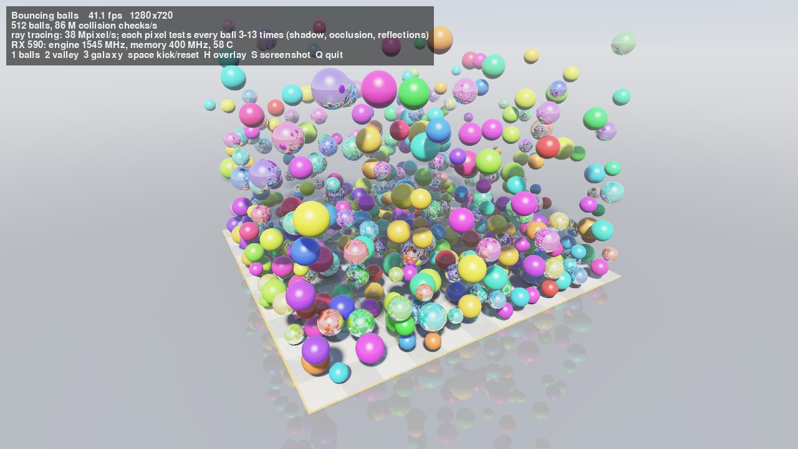
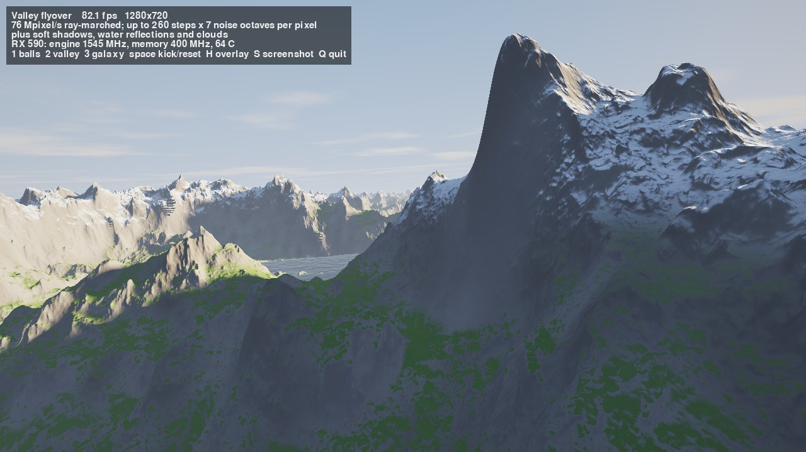
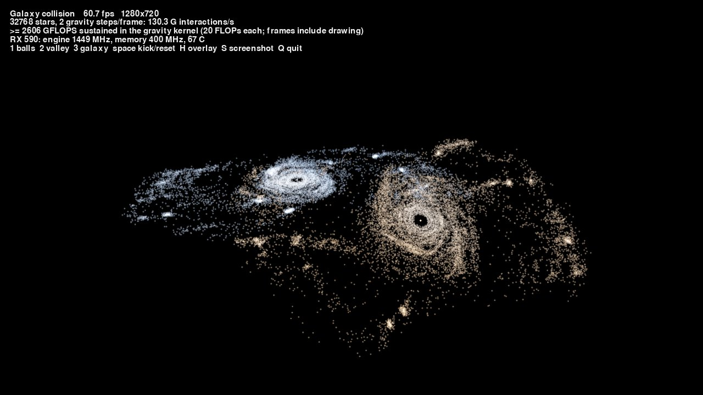

# rawgpu

Drive a PCIe GPU from userspace on an Apple Silicon Mac, over Thunderbolt/USB4,
for compute. No kernel extension, no disabled SIP, no Metal.

macOS on Apple Silicon has no eGPU support and no AMD drivers. The card
enumerates, but nothing binds to it. rawgpu builds on tinygrad's **TinyGPU**: an
Apple-signed DriverKit extension that hands raw PCIe access (config space, BAR
MMIO, DMA buffers) to userspace. On top of that, rawgpu is a small C codebase
that identifies the card and, family by family, brings it up.

**Status:** the card runs ordinary OpenCL C kernels at its rated clocks,
under amdgpu's own power management, from a C library or from Python
(`include/rawgpu.h`, [docs/LIBRARY.md](docs/LIBRARY.md)). Next: real
workloads. The first card is a PowerColor RX 590 (Polaris 30).

- **Posting works.** rawgpu posts the card from userspace: Linux amdgpu's own
  ATOM interpreter, unmodified, runs the VBIOS `ASIC_Init`. That brings up the
  voltage regulators and trains the GDDR5, and all 8 GB of VRAM then reads and
  writes correctly.
- **The SMC runs AMD's firmware and loads the engines' microcode.** Polaris
  ignores microcode written by the host. rawgpu ports amdgpu's SMU loader:
  the boot ROM accepts the signed `polaris10_k2_smc.bin`, and the firmware
  loads the SDMA, RLC and CP images from VRAM.
- **DMA works.** Both SDMA engines copy host → VRAM at 2.8 GB/s and
  VRAM → host at 3.1 GB/s through the GART, verified word for word.
- **Compute works.** One compute queue runs PM4 packets.
  - A vector add written in OpenCL C and built for gfx803 by Homebrew LLVM
    runs on the card and matches the CPU bit for bit.
  - 1M floats take 0.46 ms in VRAM, still at the VBIOS boot clocks.
- **There is a host API** (`src/amd_vi_ctx.h`): buffers, SDMA uploads, kernel
  launches.
  - At the 300 MHz boot engine clock the card does 1.36 TFLOPS of FP32
    multiply-add, 99% of what 36 CUs allow at that clock, and copies VRAM at
    35 GB/s.
- **Rated clocks.** amdgpu's Polaris power-management code runs unmodified
  inside rawgpu (`src/pp/`).
  - The SMC manages clocks, voltages, fan and power limits.
  - Measured on the GPU: engine 1540 MHz, memory 2000 MHz.
  - FP32 multiply-add: 6.97 TFLOPS. VRAM copy: 186 GB/s. About 5x the
    boot clocks.
- **A library for programs** (`librawgpu`, C and Python).
  - OpenCL C kernels are compiled at runtime by clang with AMD's device
    libraries, so every OpenCL built-in is available and the math comes from
    ocml.
  - Also in it: scratch, `__local` memory, atomics, constants, async
    launches.
  - SGEMM reaches 4.8 TFLOPS (68% of peak).

```python
import numpy as np, rawgpu
gpu = rawgpu.Device()                          # brings the card up if it needs it
x = gpu.array(np.arange(1 << 20, dtype=np.float32))
gpu.program("__kernel void sq(__global float *x) { size_t i = get_global_id(0); x[i] *= x[i]; }").sq(x, global_size=x.size)
a = np.random.rand(2048, 2048).astype(np.float32)
print(x.numpy()[:4], gpu.matmul(gpu.array(a), gpu.array(a)).numpy()[0, :4])
```

See [docs/ROADMAP.md](docs/ROADMAP.md) and [docs/LOG.md](docs/LOG.md).

## Visual demos

`demos/rawgpu_demo.py` shows what the card can do. Every pixel and every
physics step is computed by the RX 590 through librawgpu. Frames render
straight into Mac memory and appear in a window. Two frame buffers
alternate, so drawing and display overlap. They double as a stress test:
an overlay shows the frame rate, the engine clock and the temperature, and
`--bench` runs every scene and prints a summary.

```sh
python3 demos/rawgpu_demo.py                  # keys 1 / 2 / 3 switch scenes; space kicks the balls
python3 demos/rawgpu_demo.py --scene valley
python3 demos/rawgpu_demo.py --bench          # 15 s per scene, then the numbers
python3 demos/rawgpu_demo.py --record demo.mp4 --seconds 30
```

| Bouncing balls | Valley flyover | Galaxy collision |
|---|---|---|
|  |  |  |

At 1280x720, from `--bench` (2026-11-04):

- **Bouncing balls, about 47 fps.** 512 balls, with physics on the GPU
  (100 M collision checks/s), ray-traced with shadows, ambient occlusion and
  reflections. Mirror balls get 4 extra reflected rays per pixel.
- **Valley flyover, about 75 fps.** A procedural landscape ray-marched per
  pixel (up to 260 steps through 7 octaves of noise), with soft shadows,
  snow, water reflections, clouds and fog.
- **Galaxy collision, about 60 fps.** 32768 stars under full N-body gravity
  (130 G interactions/s, at least 2.6 TFLOPS sustained), drawn with atomic
  additive splatting.

Needs pygame, numpy and Pillow (`pip install pygame numpy pillow`), and
ffmpeg for `--record`.

## EmbeddingGemma 2

`models/embeddinggemma2/` runs Google's EmbeddingGemma 2 text embedding
model entirely on the RX 590, in float32. It matches the reference
implementation to cosine 1.000000.

On MuSiQue retrieval it runs about 2.5x as fast as the same model on the
M4 Pro's own GPU (PyTorch MPS):
- **Wikipedia paragraphs:** 89/s against 36/s.
- **2000-token documents:** 3.8/s against 1.5/s.
- **Inputs:** up to 8192 tokens.
- **Quality:** recall is identical.

See [models/embeddinggemma2/README.md](models/embeddinggemma2/README.md).

## Quick start

```sh
tools/install-tinygpu.sh      # verified install; then approve it in System Settings
tools/fetch-firmware.sh       # pinned, hash-checked AMD firmware into local/ (never committed)
make
./build/rawgpu probe
./build/rawgpu post           # after each power-on of the card, and after the Mac sleeps
./build/rawgpu vram-test
./build/rawgpu mc-load        # the driver's MC firmware, as amdgpu loads it
./build/rawgpu dpm-enable     # SMC firmware + microcode + power management (or `smc-load` for boot clocks)
./build/rawgpu sdma-test      # DMA host <-> VRAM, with bandwidth
make kernels                  # needs Homebrew llvm (brew install llvm); fetches AMD's device libraries once
./build/rawgpu compute-test   # compute queue, PM4 writes, then the vadd kernel
./build/rawgpu kernel-test    # the kernel ABI: work-items, scratch, atomics, LDS, math accuracy
./build/rawgpu bench-compute  # host API: bandwidth, FLOPS, SGEMM, all checked on the CPU
python3 python/test_rawgpu.py # the library end to end, from Python
```

**Keep the Mac awake while the card holds state.** Sleep resets the card (the
memory controller comes back untrained), and macOS does not report it. Use
`caffeinate -i` around long jobs. After a sleep, run `post`, `mc-load` and
`dpm-enable` again.

Approve the driver at System Settings → General → Login Items & Extensions →
Driver Extensions → TinyGPU. Check that it bound with
`ioreg -r -c IOPCIDevice | grep -A1 display`: a `tinygpu` child should appear.

| Command | What it does | Touches the GPU |
|---|---|---|
| `rawgpu probe` | Identity, family, PCIe link, BARs, family probe | Reads only (plus the ROM index write below) |
| `rawgpu cfg` | Hex dump of config space | Config reads |
| `rawgpu vbios -o FILE` | Saves the VBIOS image | Writes the SMC ROM-index register, as amdgpu does |
| `rawgpu bench [N]` | Round-trip latency of config and register reads | Reads one scratch register |
| `rawgpu dma-test [KB]` | Allocates a DMA buffer and prints its bus addresses | None (IOMMU mapping only) |
| `rawgpu atom-info` | Lists the VBIOS command tables and boot clocks | VBIOS read only |
| `rawgpu post [--trace F] [--trace-ops]` | Runs the VBIOS `ASIC_Init` | **Writes**: clocks, voltages, memory training |
| `rawgpu vram-test [--enable-fb]` | Pattern test through BAR0 and the indirect window | **Writes** a few KB of VRAM |
| `rawgpu status` | Engine, VM, SMC and microcode state; temperature | Reads only |
| `rawgpu regs PATTERN...` | Reads registers by name, e.g. `'SDMA0_*'` | Reads only; skips data ports unless named exactly |
| `rawgpu cfg [--clear-errors]` | Config space, plus PCI/PCIe/AER error status | Config reads (clearing writes the status bits) |
| `rawgpu mc-load` | The driver's MC sequencer firmware, as amdgpu loads it before power management; retrains memory | **Writes**: MC sequencer. Run after `post`, before `smc-load` |
| `rawgpu dpm-info` | The PowerPlay table and EVV voltages, parsed by amdgpu's own powerplay code | VBIOS GetVoltageInfo only; no clock or SMC writes |
| `rawgpu dpm-enable [--level L]` | On a fresh card: amdgpu's SMC start (with AVFS), then `hwmgr_hw_init()` (DPM, voltages, fan, power limits), then GFX bring-up | **Writes**: SMC firmware and tables, clocks and voltages. After `post` and `mc-load`; see docs/DPM.md |
| `rawgpu waves`, `rawgpu didt [off]`, `rawgpu gfx-reset` | Diagnostics: live shader waves (PC, status), di/dt limiter state, amdgpu's GFX soft reset | `waves` and `didt` read; `didt off` and `gfx-reset` **write** |
| `rawgpu smc-load [--force]` | Starts the SMC firmware; it loads the SDMA, RLC and CP microcode from VRAM | **Writes**: SMC RAM, 8 MB of reserved VRAM. Lasts until the card loses power |
| `rawgpu sdma-test [MB] ...` | GART + SDMA bring-up, copy and fill tests with timing (MB ≤ 127) | **Writes**: VM setup, VRAM, host buffers. Needs `smc-load` first |
| `rawgpu compute-test [--kernel F]` | RLC/MEC bring-up, one compute queue, PM4 writes and fences, then `vadd` on 1M floats | **Writes**: GFX setup, VRAM, host buffers. Needs `smc-load` first |
| `rawgpu bench-compute [--sgemm N]` | Engine clock (measured on the GPU), copy bandwidth, FP32 MAD/FMA rate, SGEMM | **Writes**: GFX/SDMA setup, VRAM, host buffers. Needs the card up |
| `rawgpu kernel-test [--skip NAME]` | The kernel ABI and ocml accuracy, checked against the CPU (`kernels/abi_test.cl`) | **Writes**: GFX/SDMA setup, VRAM. Needs the card up |
| `rawgpu kernel-info FILE` | A code object's kernels, resources and arguments | None (no GPU needed) |
| `rawgpu soft-reset` | amdgpu's SDMA/MC soft reset for blocks that report busy | **Writes**; see the recovery notes in the roadmap |
| `rawgpu reset`, `rawgpu asic-reset` | PCIe reset / amdgpu's PCI-config reset | **Writes**; neither had any effect on this card |

Nothing touches the VRAM window until the card is posted. `post` refuses to
re-run on a posted card unless you pass `--force`. If the card stops answering
(`no device answered config reads`), power-cycle the enclosure and run `post`
again: nothing from macOS has been able to reset it.

## Swapping cards

Identification is data-driven. The AMD table is generated from Linux amdgpu's
PCI ID list (`tools/gen_amd_ids.py`), and each chip family maps to a backend or
to a note saying what can drive it. `rawgpu probe` on any card tells you where
it lands:

| Card | Today |
|---|---|
| Any Polaris: RX 460/470/480/550/560/570/580/590, Radeon Pro WX 2100–7100 | `amd-vi` backend. Same code path; the firmware file differs by chip |
| Tonga / Fiji (R9 285/380/Fury/Nano) | `amd-vi` probe works; bring-up not tested |
| AMD RDNA3+ (RX 7000/9000), NVIDIA Ampere+ (RTX 30+) | Use tinygrad directly; it drives these over the same TinyGPU transport |
| GCN1/2, Vega, RDNA1/2 | Transport and probe work; needs a backend |
| Intel Arc and other vendors | TinyGPU will not bind: its signed entitlement covers only AMD and NVIDIA |

Adding a family means adding `src/<family>.c` with a `rg_backend` and one line
in `src/family.c`.

## Architecture

```
src/transport_tinygpu.c  raw PCIe over TinyGPU's socket server (one client at a time)
src/pci.c                generic config-space decoding
src/family.c             PCI ID -> family -> backend   (+ generated src/amd_ids.inc)
src/amd_vi.c             AMD GCN3/4 backend: register helpers, probe, VBIOS, post, commands
src/amd_vi_gmc.c         GMC v8: VRAM placement and the VMID0 GART
src/amd_vi_sdma.c        SDMA v3 rings, copies, fences; sdma-test
src/amd_vi_smu.c         SMU7: SMC firmware start and SMU-loaded engine microcode; smc-load
src/amd_vi_gfx.c         GFX v8: RLC/MEC bring-up, a compute queue, dispatch; compute-test
src/amd_kernel.c         AMDGPU code objects: a kernel's code and descriptor
src/amd_vi_ctx.c         host API: context, buffers, SDMA transfers, kernel launch
src/amd_vi_bench.c       bench-compute, written only against the host API
src/amd_vi_dpm.c         dpm-info, dpm-enable: the host side of src/pp
src/pp/                  amdgpu's SMU7/Polaris powerplay code, unmodified, with shims (see UPSTREAM.md)
src/upstream/            amdgpu structure headers, byte for byte (see UPSTREAM.md)
kernels/                 GPU kernels (OpenCL C), built for gfx803 by `make kernels`
src/amd_vi_regs.h        generated register subset (tools/gen_vi_regs.py)
src/amd_fw.c             AMD firmware file loading and header checks
src/amd_atom.c           ATOM BIOS header parsing
src/atom/upstream/       Linux amdgpu's ATOM interpreter, byte for byte (see src/atom/UPSTREAM.md)
src/atom/shim/           kernel-API shims so upstream compiles unmodified
src/atom/rg_atom.c       register/delay callbacks from the interpreter to the card
```

TinyGPU's extension can only be opened by an app carrying tinygrad's
user-client entitlement, so `TinyGPU.app` runs a Unix-socket server
(`TinyGPU server <path>`) that rawgpu starts on demand. DMA buffers are shared
memory passed over the socket, so they are zero-copy. Register reads cost a
socket round trip (about 10 µs); writes are pipelined. The server takes one
client at a time, so rawgpu and tinygrad can't share the GPU at once.

## Notes

- **Bandwidth.** The card runs at PCIe Gen3 x4 through a Thunderbolt 3
  enclosure (~32 Gb/s raw, less in practice). That matters for loading data,
  not for work that stays in the card's VRAM.
- **Firmware and VBIOS images are not committed.** `local/` and `*.rom` are
  gitignored.
- **Credits.** TinyGPU and the server protocol are from
  [tinygrad](https://github.com/tinygrad/tinygrad) (MIT). Register definitions,
  ATOM layouts and the vendored ATOM interpreter are from Linux amdgpu (MIT).
- **License.** TBD before this goes public. MIT would match both upstreams.
